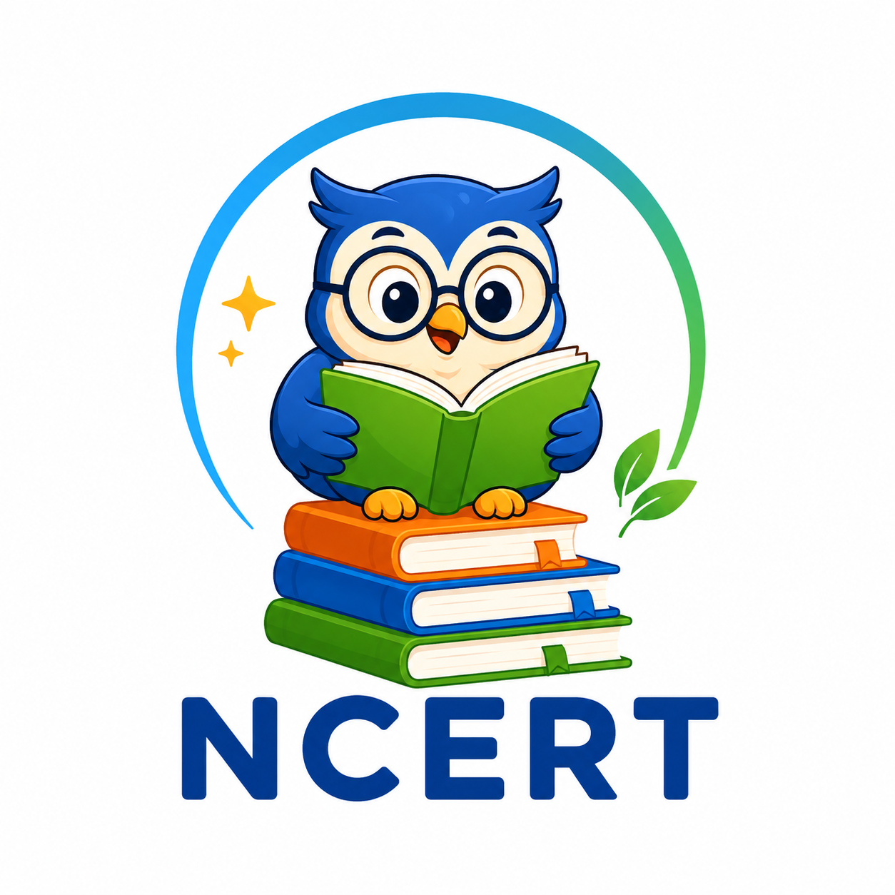

<div align="center">
  
  <h1>NCERT Books & Offline Digital Reader</h1>
  <p><strong>A Modern, Fast, and Gamified NCERT Textbooks & Solutions Reader for Android & Tablets.</strong></p>
  <p>Engineered with Flutter • Threads Obsidian Dark Aesthetic • 100% Offline Vault</p>
</div>

---

## 📖 Overview

**NCERT Books & Offline Digital Reader** is a high-performance Flutter application designed for students and educators from Class 1 through Class 12. It provides instant access to official NCERT textbooks, chapter-by-chapter PDF reading, offline vault storage, and study progress tracking.

The app features a **Threads by Meta-inspired Obsidian Dark Theme** (`#101010` backdrop, `#181818` card surfaces, `#282828` hairline borders, and pure white typography), paired with zero-clutter semantic static icons and Google Fonts (Roboto & Syne Tactile).

---

## ✨ Key Features

### 📚 Complete NCERT Textbook Catalog
- **Class 1 to Class 12**: Covers all core NCERT streams including Mathematics, Science, Social Science, English, Hindi, Sanskrit, and Environmental Studies.
- **Smart Subject Filtering**: 2-column responsive subject cards with live book counts and quick-filter chips.
- **Instant Search**: Real-time search across classes, subjects, books, and chapter titles.

### ⚡ Offline Library & Private Vault
- **100% Offline Reading**: Download entire textbooks or single chapters directly to the device's private vault (`.ncert_private_vault`).
- **Real-Time Auto-Update**: Immediate reactive state sync — downloaded books, disk storage usage, and pinned favorites update live without restarting or reloading.
- **Chapter Explorer & Cache Management**: Inspect downloaded chapter files, open offline PDFs, or free up storage on demand.
- **Starred Favorites & Bookmarks**: Save favorite textbooks and bookmark specific pages with 1-tap jump back from the reading viewer.

### 🎨 Threads Obsidian Dark Design System
- **Curated Color Palette**: Strictly locked to obsidian dark `#101010` background, `#181818` elevated surfaces, `#282828` subtle hairline borders, and `#FFFFFF` headers.
- **Clean Iconography**: Pure semantic Flutter `IconData` with static accent colors. No confusing emojis or inconsistent styling.
- **Typography**: Clean `GoogleFonts.roboto` hierarchy globally with `GoogleFonts.syneTactile` for the SWYNX brand header.
- **Floating Glass Navigation Bar**: Modern 5-tab floating bar with smooth active pill animation (**Home**, **Explore**, **Library**, **Progress**, **Profile**).

### 🏆 Gamified Learning & Progress
- **XP Progression & Level Titles**: Earn experience points by reading chapters, downloading offline books, and exploring new subjects.
- **Daily Reading Streaks**: Streak tracker with milestone celebration confetti overlays.
- **Learning Journey & Quest Badges**: Structured reading missions and unlockable trophies.

### 📢 Integrated AdMob Monetization
- **Non-Intrusive Banner Placement**: Ad banners are dynamically inserted between subject card rows at randomized positions.
- **Fail-Safe Ad Fallback**: Built-in test banner fallback and elegant dark sponsored placeholders ensure ad slots never collapse invisibly during development or offline usage.

---

## 🛠️ Technology Stack

| Layer | Technology |
| :--- | :--- |
| **Framework** | Flutter (Dart SDK ^3.12.2) |
| **PDF Engine** | `pdfrx` (Hardware-accelerated PDF rendering) |
| **Architecture** | BLoC + `ChangeNotifier` reactive service singletons |
| **Typography** | `google_fonts` (Roboto, Syne Tactile) |
| **Local Storage** | `shared_preferences`, `path_provider` |
| **Monetization** | `google_mobile_ads` (Banner Ads with Fallback) |
| **Animations** | `confetti`, custom Flutter implicitly animated widgets |
| **Notifications** | `flutter_local_notifications`, `timezone` |

---

## 📁 Project Architecture

```text
ncert_books_app/
├── assets/
│   ├── data.json                   # Official NCERT Catalog Database
│   └── logo.png                    # Application Brand Icon
├── lib/
│   ├── models/                     # Data Models (NcertBook, PdfBookmark)
│   ├── screens/                    # Modular Screen Architectures
│   │   ├── books/                  # Book Detail, Downloads, Favorites
│   │   │   └── widgets/            # BookCard, DownloadedBookTile, ChapterExplorerModal
│   │   ├── explore/                # Catalog Browse & Search
│   │   │   └── widgets/            # SubjectCard, SubjectChip
│   │   ├── home/                   # Main Dashboard & Navigation
│   │   │   └── widgets/            # HeroPlayerCard, HomeHeader, SubjectFilterBar, HomeBooksGrid
│   │   ├── onboarding/             # Student Setup & Avatar Selection
│   │   ├── profile/                # Profile, Offline Storage & Settings
│   │   ├── progress/               # Gamification Stats, Badges & Quests
│   │   └── reader/                 # Full-Screen PDF Reader
│   ├── services/                   # Core Singletons
│   │   ├── ad_service.dart         # Google Mobile Ads Controller
│   │   ├── gamification_service.dart # XP, Streaks, Favorites & Bookmarks
│   │   ├── ncert_repository.dart   # Offline JSON Catalog Provider
│   │   ├── notification_service.dart # Daily Study Reminders
│   │   └── pdf_cache_service.dart  # Offline Vault & Download Manager
│   ├── theme/                      # AppTheme (Threads Dark System) & AppResponsive
│   └── widgets/                    # Shared UI Components (AdBannerWidget, GlassNavBar, CustomSnackBar)
└── pubspec.yaml                    # Flutter Dependencies
```

---

## 🚀 Getting Started

### Prerequisites

- Flutter SDK (3.12.0 or higher)
- Android SDK (API level 21+)
- Android Studio / VS Code with Dart & Flutter extensions

### Setup & Run

1. **Clone the repository**:
   ```bash
   git clone https://github.com/Swayanshuu/NCERT-App.git
   cd NCERT-App
   ```

2. **Fetch dependencies**:
   ```bash
   flutter pub get
   ```

3. **Verify code analysis**:
   ```bash
   flutter analyze lib/
   flutter test
   ```

4. **Launch the application**:
   ```bash
   flutter run -d android
   ```

---

## 📦 Build Commands

Generate release binaries:

```bash
# Android APK
flutter build apk --release

# Android App Bundle (Play Store)
flutter build appbundle --release
```

---

## 📄 License & Attribution

- Textbook content is property of the **National Council of Educational Research and Training (NCERT)**, Government of India.
- Maintained by [Swayanshuu](https://github.com/Swayanshuu).